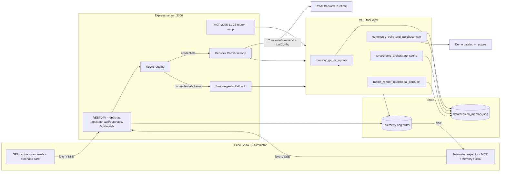

# LexaFlow

**Stateful, multi-service MCP server + multimodal Alexa+ household agent.**

LexaFlow turns Alexa+ from a single-turn Q&A loop into a **context-aware household
chief-of-staff**. One sentence can plan a dinner, build an allergy-safe grocery
cart, schedule patio lights, queue a playlist, render recipe cards, persist the
plan, and leave checkout behind an explicit voice-and-tap confirmation.

Built for the **Build, Ship, Shape: Amazon Developer Hackathon** — Alexa+ Primary
Track, AWS Builder Mini Challenge, and Open Source Mini Challenge.

[](https://modelcontextprotocol.io)
[](https://nodejs.org)
[](https://aws.amazon.com/bedrock/)
[](LICENSE)
[](tests/verify-mcp.js)

---

## Why LexaFlow

Real household requests are multi-intent, stateful, and multimodal:

> “Alexa, host Taco Night for 6 on Friday — Ben is gluten-free, set patio lights
> to warm at 7 PM, and queue Latin Jazz.”

A stateless wrapper fails this request in five different ways. LexaFlow
demonstrates what Alexa+ becomes when it can:

- **remember** household members, allergies, budgets, devices, plans, and prior turns
  across sessions in `data/session_memory.json`;
- **orchestrate** four simulated services through one MCP server in a single turn;
- **protect** the household with allergy and budget guardrails that run in code,
  not just in a prompt;
- **render** dense product, recipe, device, and routine data as multimodal cards
  while keeping the spoken answer short;
- **require** explicit confirmation before any simulated purchase; and
- **show its work** in a live JSON-RPC telemetry inspector and execution DAG.

The app runs **100% out of the box with no cloud credentials**. If AWS
credentials are present, the agent plans with **Amazon Bedrock Converse**. If
not — or if a Bedrock call fails — a deterministic **Smart Agentic Fallback
Engine** executes the same multi-service workflows so judges and live demos
never see an empty screen.

---

## 2-step quickstart

**Requirements:** Node.js **18.17+** (Node 20/22 recommended), npm, and a modern
browser. No AWS account, API key, database, or build step is required.

```bash
# 1. Install dependencies
npm install

# 2. Start LexaFlow
npm start
```

Open **http://localhost:3000**.

That is it. The server seeds `data/session_memory.json` on first run, starts the
MCP server at `/mcp`, and serves the Echo Show simulator plus telemetry console.

### Verify in one command

```bash
npm test
```

The suite spawns the real server on an ephemeral port with an isolated temporary
state file and runs **40 checks** across the MCP transport, all four tools, all
three resources, prompts, SSE, checkout guardrails, persistence, and reset. It
prints a PASS line for every check and exits non-zero on failure.

```
✓ 40/40 checks passed — LexaFlow MCP 2025-11-25 is ready.
```

### Optional: enable AWS Bedrock

```bash
# macOS / Linux
export AWS_ACCESS_KEY_ID="..."
export AWS_SECRET_ACCESS_KEY="..."
export AWS_REGION="us-east-1"
npm start
```

```powershell
# Windows PowerShell
$env:AWS_ACCESS_KEY_ID="..."
$env:AWS_SECRET_ACCESS_KEY="..."
$env:AWS_REGION="us-east-1"
npm start
```

The header chip switches from **Fallback** to **Live**. No code changes needed.
See [AWS Bedrock integration](#aws-bedrock-integration) for model access, IAM,
and configuration details.

---

## The 30-second demo

1. Open the app. The Echo Show 15 simulator shows the **Rivera household**, the
   saved **Friday Taco Night** plan, a draft Whole Foods cart, and three
   carousels rendered through the MCP tool layer.
2. Click **Taco Night for 6**. Watch the orb think, then read the spoken summary.
   The **MCP stream** fills with `initialize`, `tools/call`, and SSE frames; the
   **Execution DAG** shows memory → commerce → smart home → music → recipe →
   memory persistence.
3. Open the **Memory** tab. The plan, allergy graph, budget caps, device state,
   cart, and conversation summary update in real time.
4. Click **Swap** on a cart item. The total recalculates, allergy verification
   re-runs, and the mutation is persisted.
5. Click **Confirm Alexa+ Voice Purchase**. A second, explicit confirmation
   completes the simulated checkout, creates an order, empties the active cart,
   and appends the receipt to order history.
6. Click **Sick Day + 8 AM Flight** to see a $25 recovery-kit budget cap, bedroom
   climate control, humidifier, wake-up routine, and a five-card briefing.
7. Click **Recall + Swap Tortillas** to prove cross-session state: LexaFlow
   searches memory, quotes the saved plan, rebuilds the cart if needed, and
   mutates it without losing the allergy guardrail.
8. Use the reset icon (or **Memory → Reset**) to restore the seed state. Reset is
   itself confirmation-gated.

> All commerce, devices, orders, and camera feeds are simulated. No real
> purchases, OAuth grants, or smart-home commands leave your machine.

---

## Feature tour

### Echo Show 15 / Alexa+ simulator

- Animated ambient orb, voice waveform, speaking/listening/thinking states.
- **Web Speech API voice synthesis** with a persistent mute toggle.
- **Web Speech API speech-to-text** microphone input (Chrome/Edge; graceful
  fallback to typing elsewhere).
- Horizontal-scroll **music, recipe, device, and routine carousels** with emoji
  art, accent colors, badges, metadata, and card actions.
- **Interactive purchase card** with merchant, item ratings, dietary tags,
  allergen verification, budget meter, swap buttons, and a 1-click confirmation
  button that requires a valid token.
- Responsive dark-mode Alexa+ cyan/indigo glass design, mobile layout, keyboard
  focus states, and `prefers-reduced-motion` support.

### Live developer telemetry inspector

| Tab | What it shows |
| --- | --- |
| **MCP stream** | Exact JSON-RPC 2.0 request/response frames with method, direction, transport, session, latency, and syntax-highlighted payloads. Filter by tools, resources, or Bedrock. Follow mode auto-scrolls. |
| **Memory** | The full cross-session memory graph: household members, allergy safety graph, budget caps, connected devices, active plans, cart, conversation memory, and stored preferences. Includes raw JSON inspection and reset. |
| **Execution DAG** | Step-by-step agent plan across Memory, Commerce, Smart Home, Media, and Voice, with service colors, durations, statuses, and per-step summaries. |

The inspector is fed by `/api/events` (SSE) and hydrated from `/api/state`, so it
also reflects tool calls made by external MCP clients, not just the simulator.

### Smart Agentic Fallback Engine

When Bedrock is unavailable, the fallback is not a canned string. It:

- detects intent (`host`, `wellness`, `recall`, `media`, `smarthome`, `commerce`, `general`);
- extracts guest counts and constraints;
- calls the same four MCP tools through the same `callTool` path;
- enforces the same allergy, budget, and confirmation guardrails;
- records the same telemetry frames and execution DAG;
- returns a warm, context-aware spoken summary and card data.

This is why the demo works with zero credentials and still demonstrates the full
architecture.

---

## Architecture



**ASCII view**

```
Browser (Echo Show + inspector)
   │  fetch /api/*, SSE /api/events
   ▼
Express server ── /mcp (JSON-RPC POST + SSE GET)
   │
   ├── Agent runtime ──► AWS Bedrock Converse (if credentials)
   │        └──────────► Smart Agentic Fallback (always available)
   │
   └── MCP tools
          ├── memory_get_or_update ─────────► data/session_memory.json
          ├── commerce_build_and_purchase_cart ► catalog + budget/allergen rules
          ├── smarthome_orchestrate_scene ────► Matter/Ring/Echo device state
          └── media_render_multimodal_carousel ► APL-style cards
```

### Request lifecycle

1. The browser POSTs `/api/chat`.
2. `runAgent` inspects runtime credentials and chooses Bedrock or fallback.
3. The agent calls MCP tools in a policy-safe order: **memory → commerce →
   smart home → media → memory persistence**.
4. Every tool invocation writes a request and response frame into the telemetry
   ring buffer and fans out over SSE.
5. The agent returns a spoken summary plus structured `cart`, `commerce`,
   `scene`, `carousels`, `plan`, `dag`, runtime metadata, and telemetry.
6. The browser renders the conversation, carousels, purchase card, DAG, and
   inspector, then speaks the summary with `speechSynthesis`.
7. Checkout is a separate `/api/purchase/confirm` call with a cart id and
   confirmation token. It is never triggered by the agent.

---

## MCP `2025-11-25` Streamable HTTP specification

LexaFlow implements a JSON-RPC 2.0 MCP server at **`/mcp`** using the Streamable
HTTP transport defined by the `2025-11-25` protocol revision.

### Transport contract

| Operation | Behavior |
| --- | --- |
| `POST /mcp` | Accepts a single JSON-RPC object. Returns `application/json` by default, or a single-message `text/event-stream` when the client sends `Accept: text/event-stream` without `application/json`. |
| `GET /mcp` | With `Accept: text/event-stream`, opens the server-to-client stream with an initial comment and 20-second heartbeat. Without that header, returns a human-readable JSON capability summary for debugging. |
| `DELETE /mcp` | Terminates the session identified by `Mcp-Session-Id` and closes its streams. |
| `OPTIONS /mcp` | CORS preflight with the allowed methods. |

### Headers and sessions

- `MCP-Protocol-Version: 2025-11-25` is returned on MCP responses. An unsupported
  client version header is rejected with HTTP 400 and JSON-RPC error `-32600`.
- `initialize` creates a session and returns `Mcp-Session-Id`.
- Clients must echo `Mcp-Session-Id` on subsequent requests and on the SSE GET.
  Unknown session ids receive HTTP 404 with error `-32000`.
- `notifications/initialized` is accepted with HTTP 202.
- JSON-RPC batching is rejected for this protocol revision (`-32600`).
- Tool execution failures return a normal tool result with `isError: true`; they
  do not crash the transport. Protocol faults use standard JSON-RPC errors
  (`-32700`, `-32600`, `-32601`, `-32602`, `-32603`).

### Negotiation

`initialize` always returns:

```json
{
  "protocolVersion": "2025-11-25",
  "capabilities": {
    "tools": { "listChanged": false },
    "resources": { "subscribe": false, "listChanged": false },
    "prompts": { "listChanged": false },
    "logging": {},
    "completions": {}
  },
  "serverInfo": {
    "name": "lexaflow-mcp",
    "title": "LexaFlow — Stateful Alexa+ MCP Server",
    "version": "1.0.0"
  }
}
```

Accepted request versions for compatibility are `2025-11-25`, `2025-06-18`, and
`2025-03-26`; the response always advertises `2025-11-25`.

### Tools

Exactly four tools are registered.

| Tool | Purpose | Core arguments |
| --- | --- | --- |
| `memory_get_or_update` | Read, search, update, or reset persistent household memory. | `operation` (`get`, `search`, `update`, `reset`), `query`, `plan`, `fact`, `updates`, `confirm` |
| `commerce_build_and_purchase_cart` | Build or mutate an allergy-filtered, budget-capped Whole Foods / Amazon Fresh cart. | `action` (`build`, `swap`, `add`, `remove`, `get`, `quote`), `occasion`, `servings`, `budgetCap`, `from`, `to`, `item` |
| `smarthome_orchestrate_scene` | Control simulated Echo, Ring, Matter lights, thermostat, humidifier, routines, and security. | `action` (`set_scene`, `adjust_climate`, `run_routine`, `arm_security`, `get_status`), `scene`, `room`, `time`, `days`, `lights`, `climate`, `routine`, `security` |
| `media_render_multimodal_carousel` | Render structured APL-style cards for music, recipes, devices, or routines. | `action` (`render`, `list`), `type` (`auto`, `music`, `recipe`, `device`, `routine`), `context`, `title`, `count` |

Each tool returns:

```json
{
  "content": [{ "type": "text", "text": "<serialized structured data>" }],
  "structuredContent": { "...": "tool-specific data, including speech and cards" },
  "isError": false
}
```

The commerce tool **never completes a purchase**. It returns a
`purchase.confirmationToken`; checkout must be confirmed by the user through the
purchase card.

### Resources

| URI | Description |
| --- | --- |
| `memory://household/profile` | Household members, dietary profiles, allergy graph, budget caps, devices, scenes, routines, active plans, recent orders, conversation state, and ranked facts. |
| `memory://commerce/active-cart` | Current cart with item cards, totals, allergy verification, confirmation token, last order, and recent order history. |
| `telemetry://mcp/recent-calls` | Recent MCP JSON-RPC frames plus aggregate latency/tool-call statistics. |

All resources are `application/json` and return a single `contents` entry.

### Prompts

| Prompt | Arguments | Use |
| --- | --- | --- |
| `host-dinner` | `occasion`, `guests`, `dietary` | Plan a multi-service dinner with memory, commerce, smart home, and media. |
| `wellness-recovery` | `flightTime`, `budget` | Coordinate a recovery kit, bedroom climate, and flight-morning briefing. |
| `cross-session-recall` | `topic`, `change` | Recall a prior decision and mutate the existing cart. |
| `media-moment` | `type`, `context` | Render a targeted multimodal carousel. |

### Raw MCP examples

Initialize and capture the session id:

```bash
curl -s -D - http://localhost:3000/mcp \
  -H 'Content-Type: application/json' \
  -H 'Accept: application/json' \
  -d '{
    "jsonrpc": "2.0",
    "id": 1,
    "method": "initialize",
    "params": {
      "protocolVersion": "2025-11-25",
      "capabilities": {},
      "clientInfo": { "name": "curl-demo", "version": "1.0.0" }
    }
  }'
```

Copy the `Mcp-Session-Id` response header, then list tools:

```bash
curl -s http://localhost:3000/mcp \
  -H 'Content-Type: application/json' \
  -H 'Accept: application/json' \
  -H 'MCP-Protocol-Version: 2025-11-25' \
  -H 'Mcp-Session-Id: <SESSION_ID>' \
  -d '{"jsonrpc":"2.0","id":2,"method":"tools/list"}'
```

Call a tool:

```bash
curl -s http://localhost:3000/mcp \
  -H 'Content-Type: application/json' \
  -H 'Accept: application/json' \
  -H 'Mcp-Session-Id: <SESSION_ID>' \
  -d '{
    "jsonrpc": "2.0",
    "id": 3,
    "method": "tools/call",
    "params": {
      "name": "memory_get_or_update",
      "arguments": { "operation": "search", "query": "gluten allergy" }
    }
  }'
```

Open the server-to-client stream:

```bash
curl -N http://localhost:3000/mcp \
  -H 'Accept: text/event-stream' \
  -H 'MCP-Protocol-Version: 2025-11-25' \
  -H 'Mcp-Session-Id: <SESSION_ID>'
```

Terminate the session:

```bash
curl -i -X DELETE http://localhost:3000/mcp \
  -H 'Mcp-Session-Id: <SESSION_ID>'
```

---

## Agent Skill

`skills/lexaflow-orchestrator/SKILL.md` follows the open Agent Skills
specification with YAML frontmatter:

```yaml
name: lexaflow-orchestrator
description: Stateful, multi-service Alexa+ household orchestration ...
version: 1.0.0
mcp_version: "2025-11-25"
```

It defines the non-negotiable policy (memory first, allergies always, explicit
checkout, persist outcomes, voice-first responses), four orchestration
playbooks, argument recipes for every tool, error handling, response style, and
the three regression scenarios. The skill is intentionally usable by any
Agent-Skills-compatible host that can reach the MCP endpoint.

---

## AWS Bedrock integration

LexaFlow uses **`@aws-sdk/client-bedrock-runtime`** with the modern **Converse**
API (not raw InvokeModel) so tool use is provider-agnostic across Anthropic
Claude and Amazon Nova.

### How the Bedrock path works

1. On startup, `getAgentRuntimeInfo()` checks for credentials.
2. If configured, `runBedrock` builds a `toolConfig` from the four MCP tool JSON
   schemas, sanitizes unsupported JSON Schema metadata, and calls
   `ConverseCommand` with a household-aware system prompt.
3. When the model returns `toolUse` blocks, LexaFlow executes those tools through
   the **same** `callTool` path used by the fallback and the HTTP `/mcp` router,
   records telemetry, and sends `toolResult` blocks back to Converse.
4. The loop repeats up to `BEDROCK_MAX_ROUNDS` (default 6), then returns the
   spoken summary, tool transcript, slots, DAG, token usage, and runtime data.
5. If any Bedrock call times out (30s) or errors, the agent logs the reason,
   runs the Smart Agentic Fallback, and labels the response
   `Smart Agentic Fallback · Bedrock error recovery`.

### Credentials and environment variables

Credentials are detected when either:

- `AWS_ACCESS_KEY_ID` **and** `AWS_SECRET_ACCESS_KEY` are set; or
- `AWS_BEARER_TOKEN_BEDROCK` is set.

The standard AWS default credential chain is also used when
`LEXAFLOW_BEDROCK=on` forces Bedrock without explicit key variables.

| Variable | Default | Purpose |
| --- | --- | --- |
| `AWS_ACCESS_KEY_ID` | — | AWS access key. |
| `AWS_SECRET_ACCESS_KEY` | — | AWS secret key. |
| `AWS_BEARER_TOKEN_BEDROCK` | — | Bedrock bearer token alternative. |
| `AWS_REGION` / `AWS_DEFAULT_REGION` | `us-east-1` | Bedrock region. |
| `BEDROCK_MODEL_ID` | `anthropic.claude-3-5-sonnet-20241022-v2:0` | Model or inference profile id. |
| `LEXAFLOW_BEDROCK` | auto | `off` forces fallback; `on` forces Bedrock / default credential chain. |
| `BEDROCK_MAX_ROUNDS` | `6` | Maximum Converse tool-use rounds (capped at 10). |
| `LEXAFLOW_TOOL_DELAY_MS` | `45` | Demo pacing delay per tool; set `0` for tests. |
| `LEXAFLOW_DATA_FILE` | `data/session_memory.json` | Absolute or relative state file override. |
| `PORT` | `3000` | HTTP port. `0` requests an ephemeral port and prints `LEXAFLOW_LISTENING`. |

### AWS prerequisites

1. Enable model access in **Amazon Bedrock → Model access** for your region.
2. Ensure the identity has `bedrock:InvokeModel` and `bedrock:Converse`
   permissions for the chosen model.
3. If using Claude 3.5 Sonnet v2, confirm the model id or cross-region inference
   profile is available in your region; override with `BEDROCK_MODEL_ID` if
   necessary (for example an `us.anthropic...` inference profile).
4. Restart the server. The top-bar chip should read **Live**.

### No-credentials behavior

Without credentials the app is fully functional. The runtime reports
`mode: "smart-fallback"`, and every response includes a `source` and
`sourceLabel` so the UI and telemetry can distinguish the path. No errors are
thrown, no retries block the UI, and no judge needs an AWS account.

---

## REST API

| Method | Route | Description |
| --- | --- | --- |
| `GET` | `/api/health` | Server status, protocol version, MCP metadata, Bedrock runtime mode, memory revision. |
| `GET` | `/api/scenarios` | The three one-click demo scenario definitions. |
| `GET` | `/api/state` | Full memory graph, recent telemetry, telemetry stats, MCP info, runtime, paths, scenarios. |
| `POST` | `/api/state/reset` | Restore the seed. Requires `{ "confirm": true }`; clears telemetry. |
| `POST` | `/api/chat` | `{ "message": "...", "sessionId": "..." }` → agent response, cart, commerce, scene, carousels, DAG, telemetry. |
| `POST` | `/api/purchase/confirm` | `{ "cartId", "confirmationToken" }` → simulated order, receipt, next empty cart. Wrong or missing tokens return HTTP 409. |
| `POST` | `/api/cart/update` | `{ "action": "swap" \| "add" \| "remove", ... }` → updated cart, telemetry, state. |
| `GET` | `/api/showcase` | Renders the initial music, recipe, and device carousels through the MCP tool layer. |
| `GET` | `/api/events` | SSE stream of `telemetry`, `memory`, and `hello` events for the inspector. |
| `GET/POST/DELETE` | `/mcp` | MCP Streamable HTTP transport. |

### Example chat call

```bash
curl -s http://localhost:3000/api/chat \
  -H 'Content-Type: application/json' \
  -d '{
    "message": "Alexa, host Taco Night for 6 on Friday — Ben is gluten-free, set patio lights to warm at 7 PM, and queue Latin Jazz."
  }'
```

The response contains `reply`, `source`, `intent`, `toolCalls`, `dag`, `cart`,
`commerce`, `carousels`, `scene`, `plan`, `latencyMs`, `runtime`, `state`,
`telemetry`, and `mcp` metadata.

---

## State, safety, and purchase guardrails

`data/session_memory.json` is the single source of truth. It is written
atomically (temp file + rename, with a Windows-safe direct-write fallback) and
reseeded automatically if missing or corrupt. Set `LEXAFLOW_DATA_FILE` to isolate
tests or run multiple demos.

### Seed household

- **Rivera household**, Seattle, `America/Los_Angeles`.
- **Maya** (owner): vegetarian, prefers organic produce and Latin jazz.
- **Ben** (child): high-severity **gluten** allergy. Every bread, tortilla, and
  seasoning must be certified gluten-free.
- **Alex** (partner): no dietary constraints; school pickup Tuesday/Thursday.
- Budget caps: **$75** per grocery order, **$320** monthly, **$25** per recovery kit.
- Connected devices: Kitchen Echo Show 15, Patio Echo Dot, Patio string lights,
  bedroom thermostat, bedroom humidifier, Ring doorbell, backyard Ring camera.
- Active plan: **Friday Taco Night** for six on the patio, with a draft taco cart.

### Guardrails enforced in code

| Guardrail | Enforcement |
| --- | --- |
| **Allergy safety** | Cart lines are compared against the household allergy graph before insertion. Blocked products never enter the cart; attempts return `ALLERGEN_BLOCKED`. Verification is recomputed after every swap/add/remove. |
| **Dietary preference** | Strict `vegetarian`/`vegan` constraints exclude meat categories during builds. |
| **Budget caps** | Optional items are dropped by priority until the total (including 8.6% demo tax) is within the cap. If core items cannot fit, the cart is flagged as over budget rather than silently misrepresented. |
| **Checkout confirmation** | Carts carry a `vp_…` token. `/api/purchase/confirm` requires both the cart id and the exact token; mismatch returns HTTP 409. The agent never calls checkout. |
| **Destructive memory reset** | `memory_get_or_update` with `operation: "reset"` requires `confirm: true`. `/api/state/reset` requires `{ "confirm": true }` and the UI uses a modal. |
| **No real purchases** | All merchants, products, orders, payment methods, and delivery estimates are demo data. |

### Memory operations

- `get` returns a compact profile snapshot plus time-decayed, safety-boosted
  relevant facts.
- `search` ranks facts by `0.6 × similarity + 0.25 × time decay + 0.15 × safety`
  and returns matching active plans.
- `update` merges preferences, budget caps, members, allergies, and dietary
  profiles; upserts plans by id/title; persists facts and notes; increments the
  revision.
- `reset` restores the seed and clears telemetry.

---

## Project structure

```
lexaflow-alexa-plus-mcp/
├── data/
│   └── session_memory.json          # Seeded cross-session household state
├── public/
│   ├── index.html                   # Echo Show + inspector shell
│   ├── styles.css                   # Alexa+ cyan/indigo glass design system
│   └── app.js                       # Voice, chat, carousels, checkout, SSE, DAG
├── skills/
│   └── lexaflow-orchestrator/
│       └── SKILL.md                 # Agent Skills spec + orchestration policy
├── src/
│   ├── server.js                    # Express app, REST API, SSE, startup
│   ├── mcp-server.js                # MCP 2025-11-25 Streamable HTTP router
│   ├── tools.js                     # Tool schemas, resource/prompt registry, callTool
│   ├── bedrock-agent.js             # Converse loop + Smart Agentic Fallback + DAG
│   ├── memory-service.js            # Facts, plans, relevance scoring, snapshots
│   ├── commerce-service.js          # Cart builder, swaps, budget/allergen guardrails
│   ├── smarthome-service.js         # Matter/Ring/Echo scenes, climate, routines
│   ├── media-service.js             # Music/recipe/device/routine carousel cards
│   ├── catalog.js                   # 30 demo products + four recipes + tax
│   ├── seed.js                      # Deterministic seed memory generator
│   └── store.js                     # Atomic JSON store, telemetry ring buffer, SSE bus
├── tests/
│   └── verify-mcp.js                # 40-check end-to-end verification suite
├── LICENSE                          # MIT
├── package.json
└── README.md
```

---

## Testing

```bash
npm test
```

What the suite verifies:

- `GET /mcp` capability advertisement;
- `initialize` version, header, session id, and capabilities;
- `notifications/initialized`, `ping`, and unsupported-method errors;
- exact tool count, names, schemas, and annotations;
- memory get/search/update and revision persistence;
- commerce get/swap/build and the `ALLERGEN_BLOCKED` guardrail;
- smart-home scene scheduling, device state, climate, and humidifier state;
- music, recipe, and device carousel shapes;
- all three resources and JSON contents;
- prompt list/get;
- MCP POST SSE and GET SSE;
- `/api/health`, `/api/state`, `/api/showcase`, `/api/chat`, checkout token
  rejection, successful checkout, order-history persistence, reset confirmation,
  reset restoration, `/api/events` SSE, and MCP session termination.

The test server uses `PORT=0` and a temp `LEXAFLOW_DATA_FILE`, so running tests
never mutates your committed seed or your live demo state.

### Additional smoke checks

```bash
# Server health
curl -s http://localhost:3000/api/health

# UI and static assets
curl -s -o /dev/null -w "%{http_code}\n" http://localhost:3000/
curl -s -o /dev/null -w "%{http_code}\n" http://localhost:3000/styles.css
curl -s -o /dev/null -w "%{http_code}\n" http://localhost:3000/app.js

# MCP endpoint info
curl -s http://localhost:3000/mcp
```

---

## Troubleshooting

| Symptom | Fix |
| --- | --- |
| `EADDRINUSE` on port 3000 | Stop the other process or run `PORT=3001 npm start` (`$env:PORT=3001` on PowerShell). |
| Voice output is silent | Click the speaker icon; check browser autoplay/volume; `speechSynthesis` requires a user gesture in some browsers. |
| Microphone does nothing | Use Chrome or Edge, grant microphone permission, and serve over `localhost`/HTTPS. Typing always works. |
| Bedrock chip says Fallback | No credentials detected, `LEXAFLOW_BEDROCK=off`, or the model call failed. Check the header tooltip and server log; the app still works fully. |
| Bedrock `AccessDenied` / `ValidationException` | Enable model access in the region, verify the model id or inference profile, and check IAM `bedrock:Converse`. |
| Cart total changed after a build | Optional items were trimmed to respect the household budget cap. The purchase card flags the trim. |
| Reset did not happen | Both the UI and API require explicit confirmation. Use the modal or send `{ "confirm": true }`. |
| State looks stale after external MCP calls | The inspector refreshes on memory SSE events; click another tab or reload to force a full `/api/state` fetch. |
| Tests fail on an old Node version | Use Node 18.17+; Node 20/22 recommended. |

---

## Hackathon track mapping

| Requirement / rubric signal | Where it lives |
| --- | --- |
| Alexa+ self-hosted MCP server, `2025-11-25` Streamable HTTP | `src/mcp-server.js`, `POST/GET/DELETE /mcp` |
| Agent Skill with YAML frontmatter | `skills/lexaflow-orchestrator/SKILL.md` |
| AWS Bedrock `BedrockRuntimeClient` + `ConverseCommand` | `src/bedrock-agent.js` |
| Autonomous multi-service orchestration | Fallback flows and Bedrock tool loop across four tools |
| Context-aware, cross-session state | `data/session_memory.json`, memory service, recall scenario |
| Purchasing capabilities | Purchase card, token-gated `/api/purchase/confirm`, order history |
| Rich media / cards / carousels | `src/media-service.js`, Echo Show carousels |
| MCP Apps / multimodal display | APL-style structured cards rendered by the simulator |
| Reliability without credentials | Smart Agentic Fallback Engine |
| Open source | MIT `LICENSE` |
| Verification for judges | `npm test` → 40 checks |

---

## Limitations and demo-data notice

- Merchants, products, prices, ratings, delivery estimates, devices, camera
  feeds, and orders are **synthetic demo data**. Nothing is purchased or
  controlled in the real world.
- Carousels are structured APL-style payloads rendered by the web simulator, not
  documents submitted to a physical Echo Show.
- The Bedrock path requires model access and AWS permissions; the fallback is the
  default no-credential experience.
- Speech recognition and synthesis depend on browser support; typing is always
  available.
- The demo tax rate is a flat 8.6%.
-25 · AWS Bedrock Converse · Agent Skills · Multimodal commerce
</p>
#
